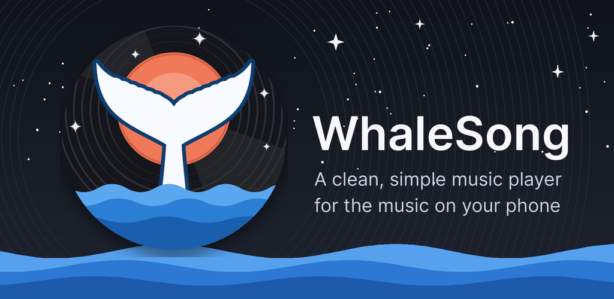
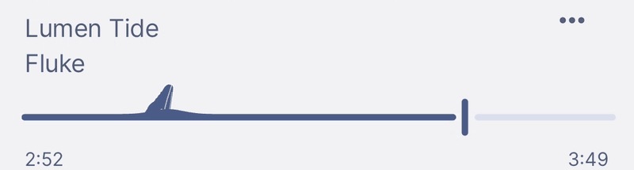
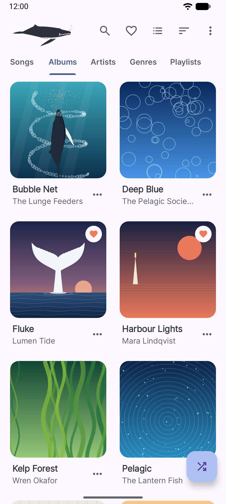
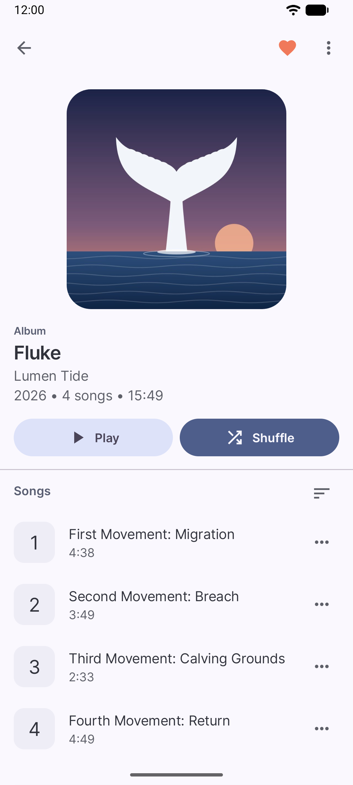
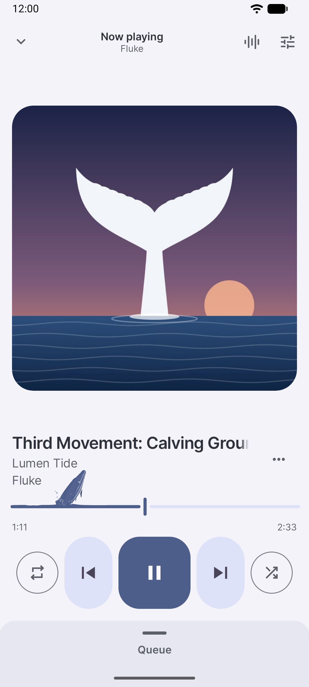
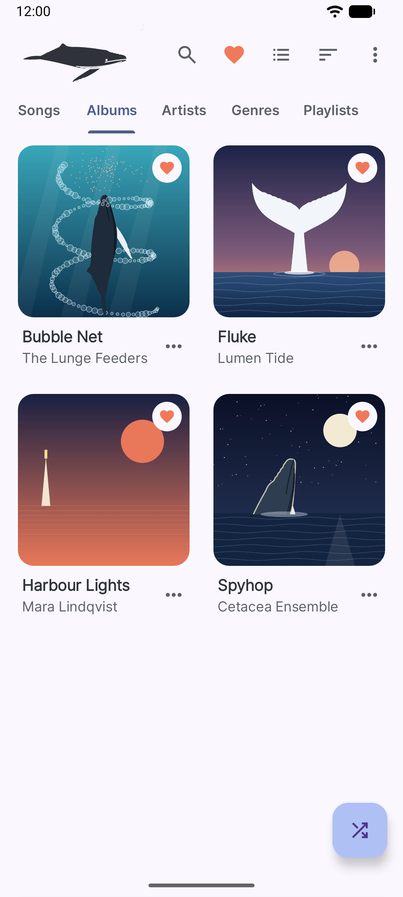
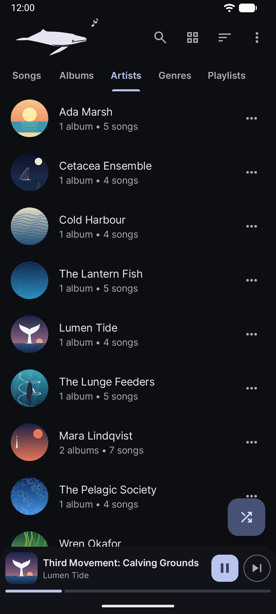

<p align="center"></p>
<h4 align="center">A local-only music player for Android, with perfect playback, a clean, intuitive interface, and humpback whales.</h4>
<p align="center">
    <a href="https://github.com/crunchbank/WhaleSong/releases/latest">
        
    </a>
    <a href="https://www.gnu.org/licenses/gpl-3.0">
        
    </a>
    
    
</p>
<h4 align="center"><a href="https://github.com/crunchbank/WhaleSong/releases/latest">Download</a> | <a href="NOTICE.md">What's changed from Auxio</a></h4>

## About

WhaleSong is a music player for the music on your phone, with a focus on perfect playback, a
good-looking, intuitive interface, humpback whales, and ease of use. It's a fork of
[Auxio](https://github.com/OxygenCobalt/Auxio) by Alexander Capehart, and keeps everything that
makes Auxio good.

What matters most:

- **Your privacy.** WhaleSong doesn't ask for internet access, so it can't send anything
  anywhere. No accounts, no ads, no tracking.
- **Clean minimalism.** Only the features that earn their place, in a quiet Material Design
  interface.
- **It plays nearly anything.** MP3, AAC, ALAC, FLAC, Opus, Vorbis and WAV, gapless, at the right
  loudness.
- **Your tags, read properly.** Multiple artists, disc numbers, release types, original dates, sort
  tags, ReplayGain and more.
- **Whales.** Now and then a humpback surfaces in the Now Playing progress line.

<p align="center">
    
</p>

## Screenshots

<p align="center">
    
    
    
    
    
</p>

## Features

🐋 marks what WhaleSong adds to Auxio.

- Playback based on [Media3 ExoPlayer](https://developer.android.com/guide/topics/media/exoplayer)
- Snappy UI derived from the latest Material Design guidelines
- Opinionated UX that prioritizes ease of use over edge cases
- Customizable behavior
- Support for disc numbers, multiple artists, release types,
precise/original dates, sort tags, and more
- Advanced artist system that unifies artists and album artists
- SD Card-aware folder management
- Reliable playlisting functionality
- 🐋 Playlists and favorites backed up automatically as .m3u files in your Music folder, so they
  survive a reinstall and open in other players
- 🐋 Favorite albums: a heart on the album's page, a heart on its cover, and a favorites-only view
- 🐋 Albums, artists, genres and playlists as a grid of covers or a list
- 🐋 Play counts, a "Plays" sort, and a list of what you've never played
- Playback state persistence
- Android Auto support
- Automatic gapless playback
- Full ReplayGain support (On MP3, FLAC, OGG, OPUS, and MP4 files)
- 🐋 ReplayGain that changes at the exact sample where each song starts, even across a gapless join
- 🐋 Streaming mode: every song at the same loudness, measured on your phone for songs with no
  ReplayGain tags
- External equalizer support (ex. Wavelet)
- Edge-to-edge
- Embedded covers support
- Search functionality
- Headset autoplay
- Stylish widgets that automatically adapt to their size
- Completely private and offline
- No rounded album covers (if you want them)
- 🐋 A library that appears in seconds: about 4 s for 7,700 songs on a Pixel 9 Pro, instead of
  about 35 s
- 🐋 Whale sightings: a humpback surfacing to blow, cruising with its calf, diving, or breaching
  in the Now Playing progress line (they can be turned off)
- 🐋 A singing humpback at the top of your library
- 🐋 Reproducible builds: the APK on GitHub is exactly what its source code builds

## Permissions

- Storage (`READ_MEDIA_AUDIO`, `READ_EXTERNAL_STORAGE`) to read and play your music files
- Services (`FOREGROUND_SERVICE`, `WAKE_LOCK`) to keep the music playing in the background
- Notifications (`POST_NOTIFICATION`) to indicate ongoing playback and music loading

That's all. There's no internet permission.

WhaleSong is not affiliated with or endorsed by the Auxio project. Please report WhaleSong
problems here, not to Auxio.

## Building

Clone with submodules (`git clone --recursive`, or `git submodule update --init --recursive`),
apply WhaleSong's two patches to the pinned ExoPlayer fork (a compile fix, and a fix that makes
the build reproducible), then build with JDK 21 and the Android SDK. Gradle installs the NDK it
needs; CMake and Ninja come from the SDK's `cmake` package:

```
git -C media apply ../patches/media-remove-stale-hagc-argument.patch \
    ../patches/media-reproducible-native-libraries.patch

export ANDROID_HOME=~/Library/Android/sdk
export PATH="$ANDROID_HOME/cmake/4.1.2/bin:$PATH"
./gradlew assembleDebug
```

## Licence

WhaleSong, like Auxio, is free software under the GNU General Public License, version 3 or
(at your option) any later version. See [LICENSE](LICENSE) and [NOTICE.md](NOTICE.md), which lists
what WhaleSong changes.

The albums, artists and cover art in the screenshots are made up, and drawn by
[art/store/demo-library.py](art/store/demo-library.py).
